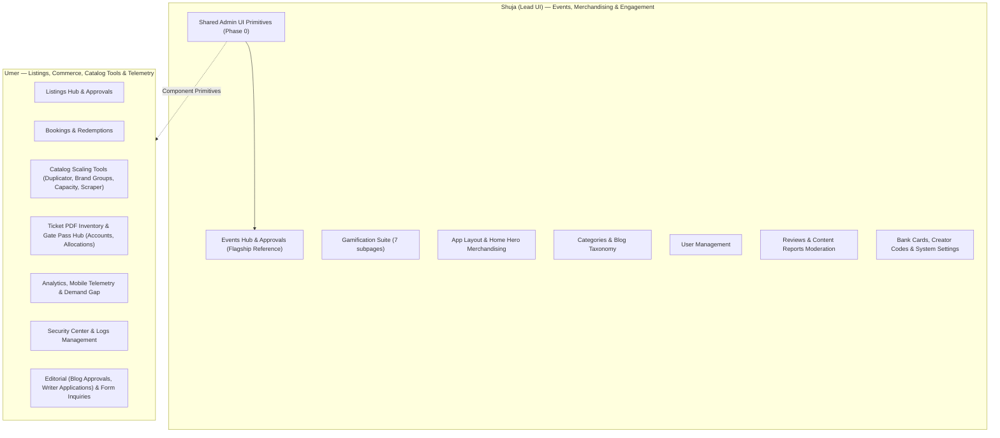
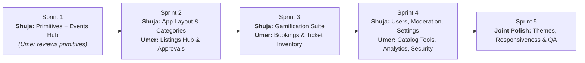

# InsideKarachi Admin UI Revamp — Master Plan & UI Page Split

## 1. Overview & Team Structure

InsideKarachi's admin portal currently consists of **45 admin routes** across catalog, ticketing, operations, and telemetry. This initiative unifies and revamps the entire Admin UI.

### Team Roles & Responsibilities

* **Shuja (Lead UI — Starts First)**:
  * Architects the shared Admin UI Component Kit (`components/admin/ui/`).
  * Establishes the design tokens, visual density, responsive conventions, and dark/light standards.
  * Revamps **Events Management & Approvals** as the flagship reference benchmark.
  * Leads the Merchandising, Taxonomy, Engagement, and Identity UI surfaces.
* **Umer (UI Partner)**:
  * Consumes the `components/admin/ui/` primitives directly.
  * Revamps **Listings Management & Approvals** and the multi-branch catalog tools.
  * Leads Commerce, Transactions, Hardware Gate Pass, and Telemetry UI surfaces.

---

## 2. Shared Admin UI Component Kit (Phase 0 — Shuja)

To ensure visual consistency and prevent UI divergence, Shuja builds the standardized component set in `components/admin/ui/`:

1. **`AdminPageShell`**: Responsive layout container with sticky header, breadcrumbs, action button slot, realtime indicator, and quick metrics bar.
2. **`AdminDataTable`**: High-density responsive data table with sortable columns, customizable column visibility, bulk selection toolbar, loading skeletons, and mobile card fallbacks.
3. **`AdminFilterBar`**: Unified filtering strip with debounced search input, facet filter chips, status dropdowns, date-range pickers, and a clear-all button.
4. **`AdminDrawer` & `AdminModal`**: Standard slide-over drawers for inspection and modal dialogs with smooth transitions.
5. **`AdminStatCard`**: KPI metrics card with trend indicators, sparklines, and icon badges.
6. **`StatusBadge` & Design Tokens**: Standard badge tokens across the portal (`active`, `pending`, `rejected`, `draft`, `flagged`, `expired`).

---

## 3. UI Page Split

### Table 1: Shuja (Lead UI — Starts First)

| Tier | Admin Module | Routes | Scope & Deliverables |
| :---: | :--- | :--- | :--- |
| 🔴 **Heavy** | **Events Hub & Approvals** | `/admin/events` `/admin/events/approvals` | **Flagship benchmark**: Visual calendar & agenda view switch, event banner cards, organizer pill, ticket tier chips, side-by-side approval review diff. |
| 🔴 **Heavy** | **Gamification Suite** *(7 subpages)* | `/admin/gamification` `/ranks`, `/challenges`, `/leaderboard`, `/qr-codes`, `/activities`, `/shares` | XP progression curve charts, badge showcases, live leaderboard table, interactive QR code generator with live print/export cards. |
| 🟡 **Medium** | **App Layout & Merchandising** | `/admin/app-layout` `/admin/home-hero` | Drag-and-drop feed section reordering, interactive hero carousel manager with mobile mockup live preview. |
| 🟡 **Medium** | **Taxonomy & Categories** | `/admin/categories` `/admin/blog-categories` | Visual hierarchy tree, drag-to-nest subcategories, Lucide icon picker popover, color tag swatches. |
| 🟡 **Medium** | **User Management** | `/admin/users` | User directory table, avatar fallbacks, role-switcher pills, points & verification status, ban/suspend action dialogs. |
| 🟢 **Light** | **Community & Moderation** | `/admin/reviews` `/admin/reports` | Flagged user reviews queue, quick approve/censor buttons, moderation reason drawer, status chips. |
| 🟢 **Light** | **Bank Cards & Offers** | `/admin/cards` | Visual bank card preview cards, bank logo selector, discount tier visual tags. |
| 🟢 **Light** | **Attribution & Creators** | `/admin/creator-codes` | Creator affiliate table, referral link generator drawer, redemption metrics. |
| 🟢 **Light** | **System Settings** | `/admin/settings` | Clean tabbed settings switchboard (general, notifications, feature flags, maintenance mode). |

**Estimated Weight:** ~43 pts (2 Heavy, 3 Medium, 4 Light)

---

### Table 2: Umer (UI Partner — Builds on Primitives)

| Tier | Admin Module | Routes | Scope & Deliverables |
| :---: | :--- | :--- | :--- |
| 🔴 **Heavy** | **Listings Hub & Approvals** | `/admin/listings` `/admin/listings/approvals` | Grid/table switcher, status toggle, verified badge, side-by-side approval review diff, media gallery drawer. |
| 🔴 **Heavy** | **Bookings & Financials** | `/admin/bookings` `/admin/redemptions` | High-density financial transactions table, payment method badges (JazzCash/Card/Cash), attendee breakdown drawer, refund trigger modal. |
| 🟡 **Medium** | **Catalog Scaling Tools** | `/admin/listings-duplicator` `/admin/brand-groups` `/admin/listing-capacity` `/admin/listing-scraper` | Multi-branch batch cloner, brand sibling tree, spreadsheet-style capacity grid, scraper job runner monitor. |
| 🟡 **Medium** | **Ticket Inventory & Gate Hub** | `/admin/ticket-pdf-inventory` `/admin/accounts` `/admin/events/[id]/device-allocation` | Secure passcode unlock screen, visual PDF ticket stock meters, device allocation grid for gate scanners, EO account cards. |
| 🟡 **Medium** | **Analytics & Telemetry** | `/admin/analytics` `/admin/mobile-events` `/admin/demand-gap` | Recharts KPI graphs, live mobile app screen view telemetry stream, search demand gap visual table. |
| 🟢 **Light** | **Editorial & Applications** | `/admin/blogs/approvals` `/admin/writer-applications` | Article previewer with clean reading typography, applicant CV/bio reader, approval acceptance drawer. |
| 🟢 **Light** | **Inquiries & Segments** | `/admin/forms` `/admin/segments` | Clean submissions table, inquiry detail modal, CSV export, audience cohort membership counts. |
| 🟢 **Light** | **Security Center & Logs** | `/admin/security/*` (4 subpages) `/admin/logs` `/admin/logs/cleanup` | Threat alert badges, IP blocklist table, infrastructure health gauges, log cleanup retention schedulers. |

**Estimated Weight:** ~44 pts (2 Heavy, 3 Medium, 3 Light)

---

## 4. Execution Sprints & Roadmap

### Sprint 1: Foundation & Benchmark
* **Shuja**:
  * Build `components/admin/ui/` primitives (`AdminPageShell`, `AdminDataTable`, `AdminFilterBar`, `StatusBadge`).
  * Revamp `/admin/events` and `/admin/events/approvals` as the live benchmark.
* **Umer**:
  * Review design primitives and align on component usage patterns.

### Sprint 2: Core Flagships
* **Shuja**: Revamp App Layout & Merchandising (`/admin/app-layout`, `/admin/home-hero`) and Taxonomy (`/admin/categories`).
* **Umer**: Revamp Listings Hub & Approvals (`/admin/listings`, `/admin/listings/approvals`).

### Sprint 3: High Density & Engagement
* **Shuja**: Revamp Gamification Suite (`/admin/gamification` + 6 subpages).
* **Umer**: Revamp Bookings & Financials (`/admin/bookings`, `/admin/redemptions`) and Ticket PDF Inventory / Gate Hub.

### Sprint 4: Tools, Operations & Systems
* **Shuja**: Revamp User Management, Moderation queues, Bank Cards, Creator Codes, and Settings.
* **Umer**: Revamp Catalog Tools (Duplicator, Scraper, Capacity), Analytics & Telemetry, Security Center, and Logs.

### Sprint 5: Joint Polish & QA
* Theme audit: Dark/light mode contrast across all 45 pages.
* Mobile and tablet responsive breakpoint verification.
* Loading state and empty state polish.
