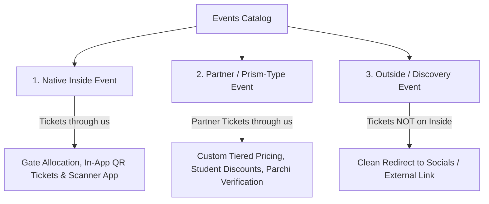

# Inside: Complete Platform Revamp & Multi-City Blueprint

**Project Name:** **Inside** (Transitioning from *Inside Karachi* to a Multi-City Platform)  
**Product Philosophy:** **Mobile-First Parity** — The web platform directly mirrors the mobile app's sleek, uncluttered design, category hierarchy, and core feature pillars.  
**Core Pillars:** **Discovery** | **Discounts (Deals-First Carousel)** | **Events (3 Ticketing Tiers)**  
**Date:** October 2026 (Synthesized from Architect Notebook Pages 1, 2 & 3: `25/10/2026`)

---

## 1. Executive Summary & Core Pillars

```
                               ┌───────────────────────────┐
                               │          INSIDE           │
                               │   (Multi-City Platform)   │
                               └─────────────┬─────────────┘
                                             │
           ┌─────────────────────────────────┼─────────────────────────────────┐
           ▼                                 ▼                                 ▼
  ┌──────────────────┐             ┌──────────────────┐              ┌──────────────────┐
  │   1. DISCOVERY   │             │   2. DISCOUNTS   │              │    3. EVENTS     │
  │ Places, Cafes,   │             │ Dedicated Visual │              │ Appealing Media, │
  │ Map/List Toggle, │             │ Voucher Carousel │              │ 3 Ticket Types,  │
  │ Working Filters  │             │ Bank Card Chips  │              │ 2 App Workflows  │
  └──────────────────┘             └──────────────────┘              └──────────────────┘
```

---

## 2. Granular Breakdown of All Architect Notes

### A. Discounts: "Should look like discounts. Carousel."
* **Voucher / Coupon Aesthetics:** Discounts must not look like generic listing cards. They need a distinct **deal aesthetic**:
  - Perforated / ticket-tear card styling or sleek gradient borders.
  - Bold discount badge (`20% OFF`, `Flat Rs. 1,000 OFF`, `BOGO`).
  - Bank card affiliation pills (`HBL`, `Meezan`, `Alfalah`, `Standard Chartered`).
  - Real-time validity countdown / expiration badges.
* **Smooth Carousel UI:**
  - Front-page dedicated, fluid touch-enabled discount carousel (web & mobile).
  - One-tap quick copy promo code or direct QR code voucher reveal.

---

### B. Events: "Should be more appealing" & The 3 Ticketing Tiers

Make event pages visually magnetic (dynamic video/poster headers, date/time chips, lineup tags, and venue maps) with **3 distinct event ticketing models**:



1. **Native Inside Event:**
   - Tickets sold entirely on Inside.
   - Real-time gate allocation, automated PDF/QR ticket generation, and organizer check-in scanner compatibility.
2. **Partner / Prism-Type Event (e.g. Prismfest):**
   - Partner event tickets hosted on Inside.
   - Supports custom ticket tiers, student verification banners, custom checkout fields, and Parchi verification.
3. **Outside / Social Event:**
   - For events discovered or listed without Inside ticketing.
   - Clean, unmistakable **"View on Instagram / Get Tickets on Organizer Site"** button redirecting directly to socials/external checkout. No dead ends or confusing empty checkouts.

#### "2 Different Types of Event Applications":
In the Organizer Portal / Event Submission flow, support two dedicated tracks:
- **Inside Native Application:** For organizers wanting full ticketing, gate allocation, and payment settlement on Inside.
- **Partner / Prism Application:** For large-scale multi-tier festival organizers with external verification, student waivers, and custom ticketing tiers.

---

### C. Search & Filters: "Filters not working on the website" (Urgent Fix)
* **Root Problem:** URL search params (`?category=...&area=...&price=...`) currently desynchronize from the server component queries, causing filter clicks to fail or reset results.
* **Filter Engine Overhaul:**
  - Unified server-side filter query builder for Next.js App Router.
  - Active filter chips with one-click clear.
  - Real-time instant count updates ("Show 42 Places").
  - Seamless toggle between **List View** and **Interactive Map View**.

---

### D. Landing Page: "Similar to Mobile App (NOT TOO MUCH)"
* **Clean, Uncluttered Visual Hierarchy:**
  1. **Top Search Bar & City Switcher:** (`Karachi ▾` | `Lahore ▾`).
  2. **Top Category Chips:** Identical icons and category taxonomies as the mobile app.
  3. **Discounts Carousel:** Distinct coupon-style deal cards.
  4. **Bite-Sized Events Rail:** High-appeal poster cards with clear ticketing badges (*Tickets on Inside* vs *External*).
  5. **Bite-Sized Trending Places:** Clean feed cards matching mobile layout tokens.
  6. **App Download Banner:** High-converting iOS & Android download badges with quick-scan QR code.

---

### E. Database Restructure & Multi-City Replication
* **Multi-City Database:** Every listing, event, deal, and layout rail has `city_id`.
* **Replicable Admin:** Top-nav city switcher (`[ Karachi ▾ ]` | `[ Lahore ▾ ]` | `[ All Cities ]`) allows managing any city with isolated RBAC.
* **Archiving Strategy:** Cold historical bookings, expired logs, and inactive listings moved to archive tables (`bookings_archive`, `events_archive`) so live app and web queries stay sub-50ms.

---

## 3. Database Schema Blueprint

```sql
-- 1. CITIES TABLE
CREATE TABLE cities (
  id UUID PRIMARY KEY DEFAULT gen_random_uuid(),
  slug VARCHAR(50) UNIQUE NOT NULL,             -- 'karachi', 'lahore', 'islamabad'
  name VARCHAR(100) NOT NULL,
  short_code VARCHAR(10) NOT NULL,               -- 'KHI', 'LHR', 'ISB'
  country_code VARCHAR(5) DEFAULT 'PK',
  currency VARCHAR(10) DEFAULT 'PKR',
  timezone VARCHAR(50) DEFAULT 'Asia/Karachi',
  center_lat DECIMAL(10, 7) NOT NULL,
  center_lng DECIMAL(10, 7) NOT NULL,
  is_active BOOLEAN DEFAULT false,
  created_at TIMESTAMPTZ DEFAULT NOW()
);

-- 2. ENHANCED EVENTS TABLE (3 Ticketing Types)
CREATE TYPE event_ticketing_type AS ENUM (
  'inside_native',     -- Gate allocation, QR scanner, native ticketing
  'partner_prism',     -- Prismfest style: custom tiers, student banners, parchi
  'external_social'    -- Redirect to socials / external link
);

ALTER TABLE events 
  ADD COLUMN IF NOT EXISTS city_id UUID REFERENCES cities(id),
  ADD COLUMN IF NOT EXISTS ticketing_type event_ticketing_type DEFAULT 'inside_native',
  ADD COLUMN IF NOT EXISTS external_ticket_url TEXT,
  ADD COLUMN IF NOT EXISTS external_social_url TEXT,
  ADD COLUMN IF NOT EXISTS gate_allocation_config JSONB;

-- 3. REVAMPED DEALS & DISCOUNTS TABLE (Coupon Carousel)
CREATE TABLE deals (
  id UUID PRIMARY KEY DEFAULT gen_random_uuid(),
  city_id UUID NOT NULL REFERENCES cities(id) ON DELETE CASCADE,
  listing_id UUID REFERENCES listings(id) ON DELETE CASCADE,
  title VARCHAR(255) NOT NULL,
  badge_text VARCHAR(50) NOT NULL,               -- '20% OFF', 'BUY 1 GET 1'
  deal_type VARCHAR(50) NOT NULL,                -- 'bank_discount', 'voucher', 'flat_percent'
  discount_percentage INT,
  promo_code VARCHAR(50),
  bank_name VARCHAR(100),                        -- 'HBL', 'Meezan Bank'
  bank_card_tiers TEXT[],                        -- ['Platinum', 'World', 'Infinite']
  terms TEXT,
  valid_from TIMESTAMPTZ NOT NULL,
  valid_until TIMESTAMPTZ NOT NULL,
  is_featured BOOLEAN DEFAULT false,
  is_active BOOLEAN DEFAULT true,
  created_at TIMESTAMPTZ DEFAULT NOW()
);
```

---

## 4. Phased Implementation Roadmap

```mermaid
gantt
    title Inside Revamp Roadmap
    dateFormat  YYYY-MM-DD
    section Phase 1: DB & Bug Fixes
    Fix Website Filter Queries (Urgent)       :2026-11-01, 2d
    DB Migration: cities, deals, event types  :2026-11-03, 3d
    Archive historical cold records           :2026-11-06, 2d
    section Phase 2: Frontend Parity
    Landing page redesign (Mobile-first)     :2026-11-08, 4d
    Coupon-style Discounts Carousel           :2026-11-12, 3d
    Events overhaul (3 Ticket Tiers & Media)  :2026-11-15, 4d
    section Phase 3: Organizer & Admin
    2 Event Application Flows (Inside/Prism) :2026-11-19, 4d
    Admin City Switcher & Replicable Tooling  :2026-11-23, 4d
    section Phase 4: Pilot & Mobile Sync
    Expo Mobile App Sync & City Header        :2026-11-27, 3d
    Launch Pilot (e.g. Lahore seed)          :2026-11-30, 3d
```

### Milestone Checklist

- [ ] **Milestone 1: Fix Filters & Core DB Setup**
  - Fix the broken website filters in Next.js listing/event directory (`app/places/page.tsx` & `app/events/page.tsx`).
  - Deploy migration for `cities`, `deals`, and `event_ticketing_type`.
  - Backfill existing Karachi listings with `city_id`.

- [ ] **Milestone 2: Visual Overhaul (Discounts Carousel & Event Media)**
  - Build the **Coupon-style Discounts Carousel** component.
  - Implement the **3 Event Ticketing Modes** (Native Gate Allocation vs Prism Partner vs Socials Redirect).
  - Redesign Event detail pages with high-appeal visual styling.

- [ ] **Milestone 3: Mobile-First Landing Page ("NOT TOO MUCH")**
  - Implement the streamlined landing page with category chips mirroring the mobile app.
  - Add prominent iOS & Android "Download the App" CTA with QR modal.
  - Hook bite-sized Event and Listing rails into city-scoped feeds.

- [ ] **Milestone 4: Event Application & Admin Replicability**
  - Add the two event application tracks: Inside Native vs Prism Partner.
  - Add the Admin City Switcher to `PremiumDashboardLayout`.
  - Validate that adding a new city replicates all configs seamlessly.
